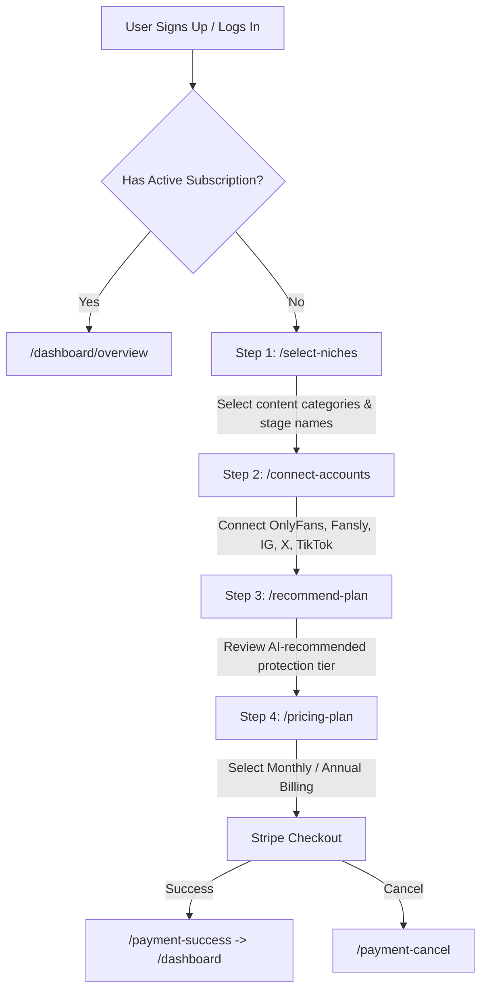

# Vantafy.com — Automated Content Protection & Media Delisting Client Portal

> **Live Platform:** [https://vantafy.com](https://vantafy.com)  
> **Client Engine:** React 18 & Vite 6  
> **Routing Engine:** React Router v7  
> **State Management:** Redux Toolkit & TanStack React Query v5  
> **Styling & UI:** Tailwind CSS v4, Radix UI Primitives, Lucide Icons  
> **Authentication:** Hybrid JWT (HttpOnly Cookies + Bearer Token) & Google OAuth 2.0  

---

## 📌 Executive Overview

**[Vantafy.com](https://vantafy.com)** is an enterprise-grade digital rights management and copyright enforcement platform built for digital creators, public figures, and talent management agencies.

The **Vantafy Client Portal** (`mediamixer_react`) is a single-page application (SPA) that serves as the mission control center for subscribers. It provides automated leak monitoring across 75+ pirate forums and cyberlockers, tracks DMCA takedown submissions, displays search engine de-indexing metrics (Google & Bing), facilitates multi-creator agency roster management, and enables real-time communication with Vantafy copyright compliance agents.

---

## 🏗️ Architecture & Project Structure

The client codebase is structured around a modular, domain-driven React architecture:

```
mediamixer_react/
├── public/                       # Static public assets (favicons, manifest, robot.txt)
├── src/
│   ├── api/                      # Core API communication layer
│   │   └── index.js              # Generic HTTP methods (GetData, PostData, UploadFile, etc.)
│   ├── assets/                   # Images, brand icons, and static graphics
│   ├── components/               # Modular UI component tree
│   │   ├── AllPhotos/            # Centralized image asset registries
│   │   ├── AuthComponent/        # Authentication forms, OTP inputs, role selectors
│   │   ├── common/               # Shared reusable modals (Terms & Conditions, Privacy Policy)
│   │   ├── DashboardComponent/   # Dashboard widgets, stats cards, scanner modals, chat
│   │   │   ├── ChatArea/         # Real-time messaging conversation threads & file attachments
│   │   │   └── MyInformation.jsx/# Agency roster tables, member cards, quota meters
│   │   ├── HomeComponent/        # Landing page sections (Hero, HowItWorks, Pricing, Radar, etc.)
│   │   ├── OtherComponent/       # Onboarding components (SelectYourNiches, StageNamesAdd, etc.)
│   │   ├── SVG/                  # Inline SVG icons and vector illustrations
│   │   ├── ui/                   # Radix UI primitive wrappers (Dialog, Sheet, Tabs, Popover, etc.)
│   │   ├── AuthProvider.jsx      # Session initialization provider
│   │   ├── AxiosInterceptor.jsx  # Route-level Axios interceptor binder
│   │   └── ProtectedRoute.jsx    # Authentication route guard with loading spinner
│   ├── hooks/                    # Custom React & TanStack React Query hooks
│   │   ├── useApi.js             # Generic TanStack Query wrappers (useFetch, usePost, usePutApi, etc.)
│   │   ├── useAuthInit.js        # Boot-time authentication state synchronizer
│   │   ├── useGoogleLoginHook.js # Google OAuth flow with role selection handler
│   │   ├── useSignIn.js / useLogout.js # Session lifecycle hooks
│   │   ├── useGetDashboardData.js# Dashboard analytical metrics query
│   │   └── useGetAgencyMemberList.js # Agency multi-creator management queries
│   ├── layout/                   # Top-level page wrappers
│   │   ├── MainLayout.jsx        # Public website shell with landing header and footer
│   │   ├── AuthLayout.jsx        # Centered card layout for authentication pages
│   │   └── DashboardLayout.jsx   # Subscriber portal shell with collapsible sidebar & mobile drawer
│   ├── lib/                      # Infrastructure & utility configurations
│   │   ├── axios.js              # Axios instances, request interceptors, and 401 refresh queues
│   │   ├── DashboardMockData.jsx # Fallback fixtures and sidebar route definitions
│   │   └── utils.js              # Class merging utilities (clsx + tailwind-merge)
│   ├── pages/                    # Route-level page views
│   │   ├── AuthPages/            # SignIn, SignUp, OtpVerify, ResetPassword, ChangePassword
│   │   ├── DashboardPages/       # Overview, RequestRemoval, MyAccount, MyInformation, Plans, Messages
│   │   ├── LandingPages/         # Public Home page
│   │   ├── NotFound/             # 404 Error page
│   │   ├── SelectNiches.jsx      # Onboarding Step 1: Content category & alias selection
│   │   ├── ConnectAccounts.jsx   # Onboarding Step 2: Protected platforms connection
│   │   ├── RecommendPlan.jsx     # Onboarding Step 3: AI-recommended protection tier
│   │   ├── PricingPlan.jsx       # Onboarding Step 4: Billing frequency & package selection
│   │   └── PaymentSuccess.jsx / PaymentCancel.jsx # Stripe checkout outcome views
│   ├── Redux/                    # Global client-side state
│   │   ├── slices/authSlice.js   # Redux slice for user profile, tokens, and auth status
│   │   └── store.js              # Redux store configuration
│   ├── router/                   # React Router v7 configuration
│   │   ├── router.jsx            # Master browser router combining layout trees
│   │   ├── GeneralRoutes.jsx     # Public landing & legal routes
│   │   ├── AuthRoutes.jsx        # Authentication routes
│   │   └── DashboardRoutes.jsx   # Authenticated subscriber dashboard routes
│   ├── shared/                   # Shared UI fragments (Logos, Headers, Footers)
│   ├── utils/                    # Global helpers (apiUtils, formatting)
│   ├── index.css                 # Tailwind CSS v4 directives and custom scrollbar utilities
│   └── main.jsx                  # Application entry point with Providers setup
├── .env                          # Environment variables configuration
├── package.json                  # Dependencies and NPM scripts
├── vercel.json                   # Vercel SPA routing and cache control configuration
└── vite.config.js                # Vite build settings and path aliases (`@` -> `./src`)
```

---

## 🔐 Authentication & Session Lifecycle

The client operates in tandem with Vantafy's **Hybrid JWT Authentication** backend, supporting both modern browser cookie security and bearer token fallbacks.

### 1. Dual Sign-In Mechanisms
* **Google OAuth 2.0 (`@react-oauth/google`)**:
  - Implements implicit OAuth flow managed via `useGoogleLoginHook`.
  - Captures Google access tokens and passes them to the backend (`/api/user/auth/google/`).
  - Supports role specification (`customer` vs `agency`). If a role is undetermined upon initial sign-in, an interactive role selection modal prompts the user before concluding registration.
* **Email & Password Authentication**:
  - Direct credentials login (`/api/user/auth/signin/`) via `useSignIn`.
  - Email OTP verification (`/api/user/auth/send-otp/`, `/api/user/auth/verify-otp/`).
  - Self-service password reset and recovery flows.

### 2. Cookie-First Token Flow & Refresh Queue
Configured in `src/lib/axios.js`:
* **HttpOnly Session Cookies:** Every request is dispatched with `withCredentials: true`, ensuring that `access_token` and `refresh_token` cookies stored by the browser are automatically forwarded to Django.
* **Bearer Fallback:** For hybrid environments, an Axios request interceptor inspects `localStorage` for fallback tokens and injects `Authorization: Bearer <token>` when present.
* **Automatic Silent Token Refresh Queue:**
  1. When an active session encounters an `HTTP 401 Unauthorized` response, the original request is intercepted.
  2. Further incoming requests are temporarily queued in `failedQueue`.
  3. A single refresh request is dispatched to `/api/user/token/refresh/`.
  4. Upon successful rotation, the new tokens are stored, the queue is replayed with the new credentials, and the original request is executed transparently without interrupting the user.
  5. If token refresh fails (session expired or revoked), the queue is rejected, local tokens are flushed, Redux dispatches `clearUser()`, and the user is redirected to `/auth/signin`.

### 3. Route Guarding (`ProtectedRoute`)
Protected application routes are wrapped by `ProtectedRoute.jsx`:
* Evaluates `selectIsAuthenticated` and `selectAuthLoading` from Redux.
* Displays a loading spinner during initial boot-time authentication resolution (`useAuthInit`), completely preventing flash-of-unauthenticated-content (FOUC).
* Redirects unauthenticated users to `/auth/signin`.

---

## 🚀 Creator Onboarding & Protection Funnel

New subscribers undergo a tailored 4-step onboarding sequence designed to calibrate the spider engine before payment:



1. **Niches & Aliases (`/select-niches`)**:
   - Fetches active categories from `/api/user/niches/` (backed by the decoupled `AvailableNiche` catalog).
   - Allows creators to select content tags (e.g., *Instagram Influencer*, *YouTube Creator*, *Fitness & Health*).
   - Captures stage names, legal names, and alias variations used by spider scrapers to identify pirated content.
2. **Platform Registration (`/connect-accounts`)**:
   - Registers legitimate creator platforms (OnlyFans, Fansly, Instagram, Twitter/X, TikTok).
   - Pre-seeds legitimate social handles so that official profiles are whitelisted and never flagged as infringing.
3. **AI Plan Recommendation (`/recommend-plan`)**:
   - Analyzes the creator's platform count and content footprint to suggest the optimal protection tier.
4. **Subscription Checkout (`/pricing-plan`)**:
   - Offers dynamic toggle between **Monthly** and **Annual** billing (with 20% annual savings).
   - Dynamically renders **Agency Packages** when logged in under an agency account.
   - Redirects to Stripe Checkout for secure credit card and payment processing.

---

## 📊 Dashboard Modules & Core Features

### 1. Overview (`/dashboard/overview`)
The primary analytical command center:
* **Metric Cards:** Real-time counters for infringing sites, detected images, detected video leaks, successfully delisted links, and estimated potential revenue protected.
* **Multi-Member Switcher (Agency):** Agency administrators can toggle between managed creators seamlessly; all dashboard charts and metrics update instantly for the selected talent.
* **Scan Trigger Actions:**
  - `Initial Scan`: Launches an on-demand comprehensive crawler across 75+ pirate boards.
  - `Scan Result`: Inspects real-time match results, image thumbnails, and source URLs.
  - `List of Delisted Links`: Searchable modal displaying all links removed from Google Search or deleted from pirate file hosts.

### 2. Request Removal (`/dashboard/request-removal`)
* Allows creators or agency managers to submit urgent infringing URLs directly.
* Displays quota tracking: total images removed, videos detected, and remaining manual requests for the billing cycle.
* Dispatches takedown jobs directly into Vantafy's automated DMCA notice generator.

### 3. My Account (`/dashboard/my-account`)
Individual creator account settings:
* **Profile Details:** Real-time avatar upload and personal information editing.
* **Niches Management:** Update content categories as the creator's portfolio evolves.
* **Stage Names to Protect:** Add or remove aliases, handles, and keywords scanned by the crawlers.
* **Authorized Sites Whitelist:** Whitelist approved syndication partners, affiliate landing pages, or personal blogs to prevent accidental takedowns.
* **Password & Security:** Self-service credential update (disabled for Google OAuth accounts).

### 4. Agency Roster Workspace (`/dashboard/my-information`)
Exclusive to users with the `agency` role:
* **Member Capacity Indicator:** Visual meter showing active members versus total subscription capacity (`member_limit`). Issues proactive alerts when fewer than 3 seats remain.
* **Talent Management Table:** Add new creators, edit stage names, manage social media profiles, and upload creator photos.
* **Member Limits Enforcement:** Prevents adding members beyond the agency's tier quota and guides the user to upgrade their plan.

### 5. Plans & Subscriptions (`/dashboard/plans`)
* Displays current plan tier (Starlet, Star, Superstar, VIP, or Agency custom).
* Visualizes billing renewal dates, quota consumption, and available features.
* One-click checkout integration for tier upgrades and add-ons.

### 6. Support & Live Messaging (`/dashboard/message`)
* Two-way secure chat interface connecting creators directly to dedicated Vantafy compliance managers.
* Supports sending and receiving documents, image screenshots, and DMCA evidence files.

### 7. Affiliate & Referral System (`/dashboard/affiliate-program`)
* Generates unique referral tracking links.
* Displays real-time referral sign-up histories and accrued payout commissions.

---

## 👥 Dual-Role System: Creator vs Agency

The interface dynamically adapts its layout, routing, and capabilities based on the authenticated user's `role`:

| Feature / Workspace | Creator (`customer`) | Agency (`agency`) |
| :--- | :--- | :--- |
| **Primary Scope** | Single creator identity | Multi-creator talent portfolio |
| **Dashboard Overview** | Personal scan metrics | Talent dropdown switcher + aggregated data |
| **Roster Management (`My Information`)** | ❌ Hidden from sidebar | ✅ Full talent roster and seat management |
| **Stage Names & Niches** | Configured in `My Account` | Configured per individual talent profile |
| **Subscription Packages** | Individual tiers (Starlet, Star, Superstar, VIP) | Agency bulk-seat enterprise tiers |
| **Authorized Whitelists** | Personal authorized domains | Domain whitelists per managed creator |

---

## ⚡ State Management & Caching Strategy

The frontend combines **Redux Toolkit** for synchronous global state with **TanStack React Query v5** for asynchronous server state:

### 1. TanStack React Query Configuration
Configured in `src/main.jsx`:
```javascript
const queryClient = new QueryClient({
  defaultOptions: {
    queries: {
      staleTime: 1000 * 60 * 5,       // Data remains fresh for 5 minutes (prevents refetch spam)
      gcTime: 1000 * 60 * 60,         // Retains cache in memory for 1 hour
      refetchOnWindowFocus: false,    // Eliminates skeleton flicker on tab switching
      refetchOnMount: false,          // Instant renders from memory on component remount
    },
  },
});
```

### 2. Generic Query Wrappers (`src/hooks/useApi.js`)
* **`useFetch`**: Standardized data retrieval with built-in `localStorage` rehydration cache (`cq_cache_`) ensuring zero-latency initial renders while network requests validate in the background.
* **`usePost`, `usePutApi`, `useDeleteApi`**: Standardized mutation hooks with automatic query cache invalidation (`invalidateQueries`) upon successful mutation.

### 3. Redux Store (`src/Redux/slices/authSlice.js`)
* Manages `user` profile data, `isAuthenticated` boolean, and `isLoading` boot state.
* Synchronizes authentication tokens to `localStorage` as secondary fallback for non-cookie environments.

---

## ⚙️ Environment Variables

Create a `.env` file in the project root directory:

```ini
# Backend API Base URL (Django REST Framework)
VITE_BASE_URL=https://dashboard.vantafy.com/api

# Google OAuth 2.0 Credentials
VITE_GOOGLE_CLIENT_ID=your-google-client-id.apps.googleusercontent.com
VITE_GOOGLE_SECRET_KEY=your-google-client-secret

# Media & Storage Host
VITE_IMAGE_URL=https://dashboard.vantafy.com

# Public Client URL
VITE_APP_FRONTEND_URL=https://vantafy.com
```

### Environment Reference Table

| Variable | Description | Example (Local Dev) | Example (Production) |
| :--- | :--- | :--- | :--- |
| `VITE_BASE_URL` | DRF REST API root | `http://127.0.0.1:8000/api` | `https://dashboard.vantafy.com/api` |
| `VITE_GOOGLE_CLIENT_ID` | Google OAuth Client ID | `97995...apps.googleusercontent.com` | `97995...apps.googleusercontent.com` |
| `VITE_GOOGLE_SECRET_KEY` | Google OAuth Secret | `GOCSPX-...` | `GOCSPX-...` |
| `VITE_IMAGE_URL` | Media files root | `http://127.0.0.1:8000` | `https://dashboard.vantafy.com` |
| `VITE_APP_FRONTEND_URL` | Frontend canonical URL | `http://localhost:5173` | `https://vantafy.com` |

---

## 🛠️ Installation & Development Workflow

### Prerequisites
* **Node.js:** `v18.0.0` or higher
* **Package Manager:** `npm` (v9+) or `pnpm` (v8+)

### 1. Install Dependencies
```bash
npm install
```

### 2. Start Local Development Server
```bash
npm run dev
```
The application will launch at `http://localhost:5173` with Vite Hot Module Replacement (HMR).

### 3. Build for Production
```bash
npm run build
```
Compiles TypeScript/JSX assets, bundles CSS via Tailwind CSS v4, and generates optimized static distribution files in the `dist/` directory.

### 4. Preview Production Build Locally
```bash
npm run preview
```

---

## 🌐 Production Deployment

### 1. Vercel Deployment
The repository includes a ready-to-use [`vercel.json`](file:///c:/Users/sawaf/Projects/mediamixer/mediamixer_react/vercel.json) configured for Single Page Applications:
```json
{
  "headers": [
    {
      "source": "/(.*)",
      "headers": [
        { "key": "Cache-Control", "value": "public, max-age=0, must-revalidate" }
      ]
    }
  ],
  "rewrites": [
    { "source": "/(.*)", "destination": "/index.html" }
  ]
}
```

### 2. Nginx Static SPA Deployment
When deploying on an Ubuntu/Debian Linux server behind Nginx:

```nginx
server {
    listen 80;
    server_name vantafy.com www.vantafy.com;
    return 301 https://$host$request_uri;
}

server {
    listen 443 ssl http2;
    server_name vantafy.com www.vantafy.com;

    ssl_certificate /etc/letsencrypt/live/vantafy.com/fullchain.pem;
    ssl_certificate_key /etc/letsencrypt/live/vantafy.com/privkey.pem;

    root /var/www/mediamixer_react/dist;
    index index.html;

    # Static file caching
    location ~* \.(?:css|js|jpg|jpeg|gif|png|ico|svg|woff|woff2|ttf)$ {
        expires 1y;
        add_header Cache-Control "public, immutable";
    }

    # SPA fallback to index.html
    location / {
        try_files $uri $uri/ /index.html;
    }
}
```

---

## 🔒 Security Best Practices

1. **XSS Protection:** Authentication tokens are stored in `HttpOnly` cookies configured by the backend. Client-side JavaScript cannot read these cookies, shielding sessions against malicious scripts.
2. **CORS & Credentials:** All API requests use `withCredentials: true`. The backend restricts `CORS_ALLOWED_ORIGINS` strictly to authorized client domains.
3. **Route Guards:** Critical dashboard pages and onboarding funnels are wrapped with `<ProtectedRoute>`, ensuring unauthenticated guests cannot view protected screens or cached data.
4. **Input Sanitization:** User-submitted removal URLs and search terms are sanitized before submission to prevent payload injection into scraping engines.

